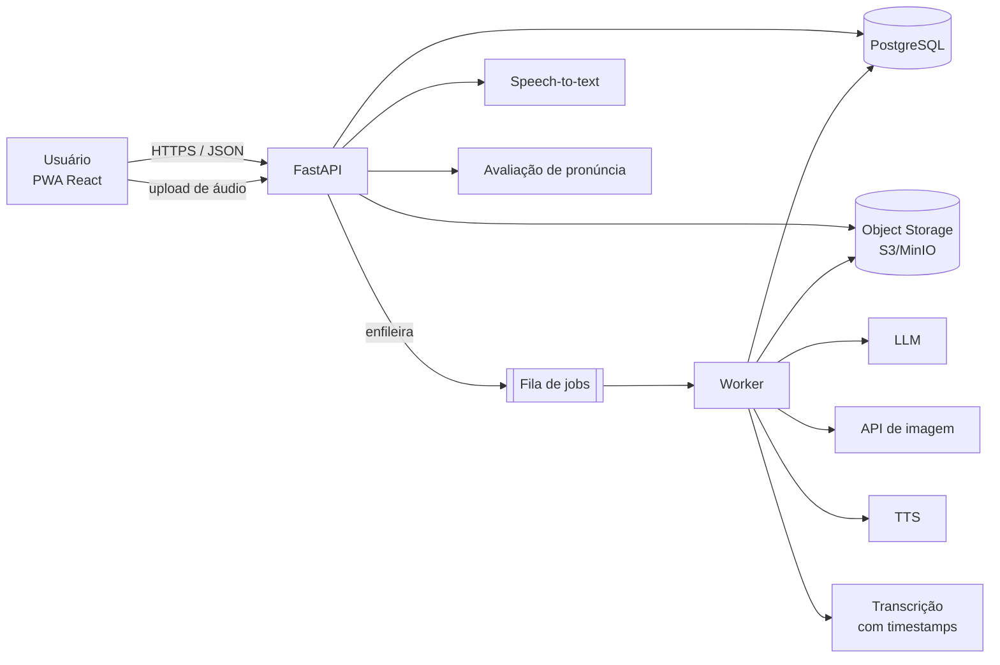
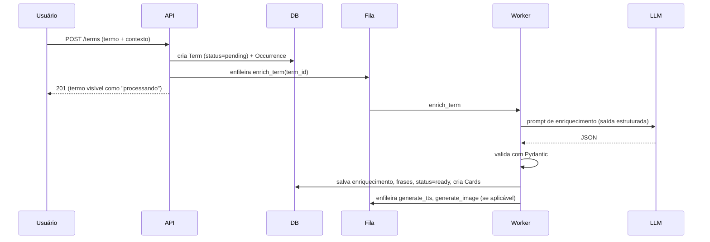
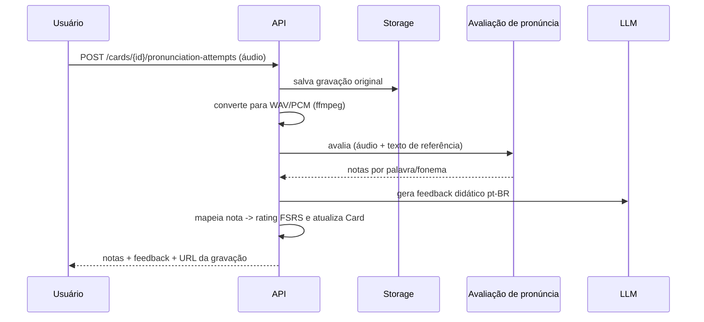
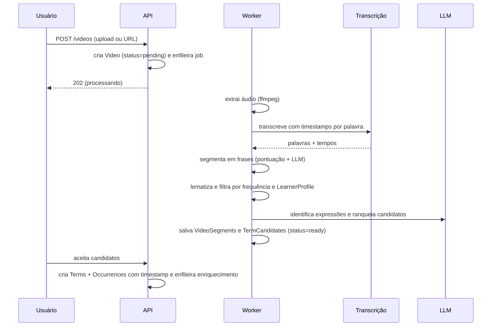
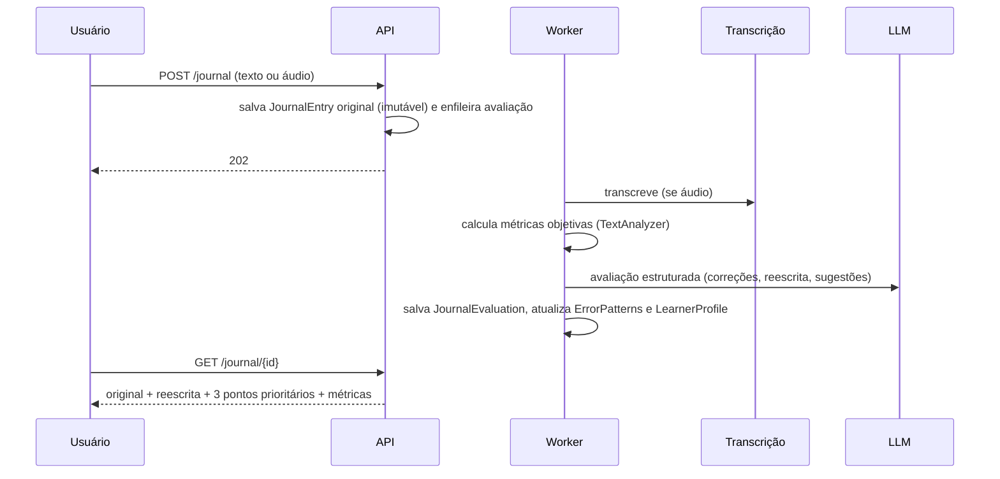
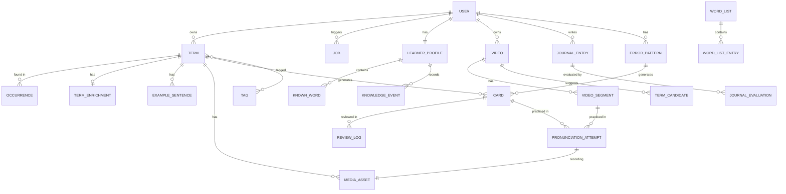

# Vocabulary Builder — Documento de Visão e Especificação Inicial

> **Propósito deste documento:** servir como fonte única de contexto de alto nível para agentes de IA (e humanos) que vão participar do desenvolvimento. Ele descreve o problema, os objetivos, o escopo funcional, as decisões técnicas já tomadas, o modelo de domínio proposto, o roadmap e as questões em aberto.
>
> **Status:** ideia inicial / pré-desenvolvimento.
> **Versão do documento:** 1.1 — adiciona F-16 (gerador de palavras frequentes), F-17 (estúdio de vídeo), F-18 (diário) e F-19 (modelo do aprendiz).
> **Nome do projeto:** provisório ("Vocabulary Builder"). Pode ser alterado.
> **Idioma do código:** inglês (nomes de variáveis, classes, tabelas, endpoints, commits). **Idioma da documentação e da interface:** português (pt-BR), com o conteúdo de estudo em inglês.

---

## Sumário

1. [Contexto e problema](#1-contexto-e-problema)
2. [Visão do produto](#2-visão-do-produto)
3. [Público-alvo e premissas](#3-público-alvo-e-premissas)
4. [Princípios de design](#4-princípios-de-design)
5. [Escopo funcional](#5-escopo-funcional)
6. [Requisitos não funcionais](#6-requisitos-não-funcionais)
7. [Stack tecnológica](#7-stack-tecnológica)
8. [Arquitetura](#8-arquitetura)
9. [Modelo de domínio](#9-modelo-de-domínio)
10. [Repetição espaçada (FSRS)](#10-repetição-espaçada-fsrs)
11. [Integração com IA](#11-integração-com-ia)
12. [Pipeline de áudio e pronúncia](#12-pipeline-de-áudio-e-pronúncia)
13. [API (rascunho)](#13-api-rascunho)
14. [Roadmap por fases](#14-roadmap-por-fases)
15. [Questões em aberto](#15-questões-em-aberto)
16. [Riscos e cuidados](#16-riscos-e-cuidados)
17. [Diretrizes para agentes de IA](#17-diretrizes-para-agentes-de-ia)
18. [Glossário](#18-glossário)

---

## 1. Contexto e problema

O usuário (único usuário do sistema, ver seção 3) está praticando inglês assistindo a vídeos e encontra com frequência palavras e expressões que não conhece. Hoje ele anota esses termos manualmente, mas **não faz nada sistemático com eles depois**. As anotações ficam paradas e o vocabulário não é consolidado.

Problemas concretos:

- Palavras anotadas soltas perdem o contexto em que foram encontradas.
- Não há um processo de revisão, então a maioria das palavras é esquecida.
- Não há distinção entre palavras já dominadas e palavras que exigem mais prática.
- Não há prática de pronúncia nem feedback sobre a própria fala.
- Buscar significados, exemplos, imagens e vídeos para cada palavra manualmente é trabalhoso demais para virar hábito.
- Não há um ponto de partida para quando ainda não existe uma lista própria de palavras.
- Não há prática de produção livre (escrever e falar sem roteiro) nem uma forma de medir a evolução ao longo do tempo.

## 2. Visão do produto

Um aplicativo web (instalável no celular como PWA) onde o usuário **joga palavras e termos com o mínimo de atrito** e o sistema **cuida de todo o resto**:

1. Coleta as palavras/termos (com o contexto em que foram encontrados, quando disponível).
2. Usa IA para entender e enriquecer cada termo (significados, pronúncia, registro, colocações, tradução de apoio).
3. Gera frases de exemplo adequadas ao nível e aos interesses do usuário.
4. Gera imagens ou mnemônicas para associação.
5. Encontra/vincula trechos de vídeo em que o termo é falado.
6. Agenda revisões com repetição espaçada.
7. Classifica cada termo de acordo com o desempenho do usuário (termos errados aparecem mais; termos dominados aparecem menos).
8. Permite praticar a pronúncia: o usuário grava sua fala, a IA avalia inteligibilidade e erros de pronúncia, e o usuário pode ouvir a própria gravação e compará-la com uma referência.
9. Sugere palavras e expressões frequentes do inglês para quem ainda não tem uma lista própria, sem mostrar o que o usuário já sabe.
10. Transforma vídeos (upload ou YouTube) em material de prática: modos de assistir com pausa para repetição, ditado e avaliação de pronúncia, além de extrair automaticamente termos adequados ao nível do usuário.
11. Oferece um diário em inglês (texto ou áudio) com avaliação e sugestões de melhoria, usado também para medir a evolução do usuário ao longo dos meses.

**Frase-resumo:** "Anote a palavra uma vez; o app transforma em vocabulário ativo."

## 3. Público-alvo e premissas

- **Uso pessoal, single-user.** Não é um produto comercial neste momento. Publicação e eventual abertura a outros usuários serão tratadas no futuro.
- O usuário é falante nativo de português (pt-BR), aprendendo inglês, com nível intermediário (premissa; ver questões em aberto).
- O usuário é desenvolvedor fullstack experiente (foco em backend, experiência como tech lead). O projeto também pode servir como ambiente de aprendizado e experimentação.
- Consequências da premissa single-user:
  - Autenticação simples é suficiente (ver seção 6), mas o modelo de dados deve conter `user_id` para não bloquear multiusuário no futuro.
  - Custos de API devem caber em camadas gratuitas ou em poucos dólares por mês.
  - Não há necessidade de escala horizontal, filas distribuídas robustas ou SEO.

## 4. Princípios de design

1. **Contexto acima da palavra isolada.** Sempre que possível, guardar a frase original e a fonte (vídeo + minuto). O contexto melhora a memorização e permite que a IA desambigue o sentido correto.
2. **Captura sem atrito.** Adicionar uma palavra deve levar segundos. Enriquecimento é assíncrono; o usuário nunca espera a IA para continuar.
3. **Revisões curtas e diárias.** Melhor 10 minutos todo dia do que 1 hora esporádica. Limites diários configuráveis.
4. **Significado e pronúncia são habilidades separadas.** Cada uma tem seu próprio agendamento de revisão.
5. **Progressão de dificuldade.** Do reconhecimento passivo até a produção ativa (escrever e falar).
6. **Não reinventar o que já existe.** Usar FSRS pronto, APIs especializadas de pronúncia, serviços existentes de busca de vídeo quando fizer sentido.
7. **Portabilidade dos dados.** O usuário deve poder exportar seus dados (ex.: JSON e formato importável no Anki).
8. **Determinismo onde importa.** O agendamento (FSRS) é determinístico e auditável; a IA enriquece e dá feedback, mas não decide o agendamento.
9. **Um único modelo do aprendiz.** Todas as funcionalidades consultam e alimentam a mesma representação do que o usuário sabe (F-19): palavras conhecidas, faixa de frequência, nível estimado e padrões de erro.
10. **Régua constante para medir evolução.** Dados originais (textos e áudios) são sempre preservados; cada avaliação registra modelo, versão do prompt e versão das métricas; comparações ao longo do tempo reavaliam os dados antigos com o mesmo avaliador atual.

## 5. Escopo funcional

As funcionalidades estão identificadas por código (`F-xx`) para referência em tarefas, issues e commits. A fase de cada uma está na seção 14.

### F-01 — Captura de termos

- Entrada rápida de um termo individual com campos:
  - `term` (obrigatório): palavra, phrasal verb, expressão, idiom.
  - `context_sentence` (opcional, incentivado): frase em que o termo apareceu.
  - `source_url` (opcional): link do vídeo/página.
  - `source_timestamp` (opcional): minuto/segundo no vídeo.
  - `notes` (opcional): observações livres do usuário.
- **Importação em lote:** colar uma lista (um termo por linha, com suporte opcional ao formato `termo | frase de contexto`). Cada linha vira um termo pendente de enriquecimento.
- **Deduplicação:** se o termo (forma canônica) já existir, o novo contexto é adicionado como nova ocorrência do termo existente, em vez de criar duplicata.
- **Futuro (fase posterior):**
  - Web Share Target da PWA (compartilhar texto de outro app do celular para o app).
  - Extensão de navegador para YouTube: clicar numa palavra da legenda salva termo, frase e timestamp automaticamente.

### F-02 — Enriquecimento por IA

Ao ser criado, cada termo entra em uma fila de enriquecimento assíncrono. A IA (LLM) deve retornar um objeto estruturado (ver seção 11.2) contendo:

- **Forma canônica / lema** (ex.: "gave up" → "give up"), mantendo a forma original na ocorrência.
- **Tipo do termo:** palavra, phrasal verb, idiom, collocation, gíria, sigla etc.
- **Classe gramatical.**
- **Significado no contexto em que foi encontrado** (quando houver frase de contexto), em inglês simples.
- **Outros significados comuns** (limitados, priorizados por frequência).
- **Tradução de apoio** para pt-BR (não deve ser o foco principal da revisão).
- **Pronúncia:** transcrição IPA (variante americana como padrão; ver questões em aberto).
- **Registro:** formal, neutro, informal, gíria, ofensivo, técnico.
- **Colocações comuns.**
- **Sinônimos e antônimos** relevantes.
- **Confusões comuns** (ex.: affect × effect; falsos cognatos com o português).
- **Nível CEFR estimado** (A1–C2) e frequência aproximada de uso.
- **Flag de "imaginabilidade"**: indica se o termo é concreto o suficiente para gerar uma boa imagem (usado em F-04).

O usuário pode editar qualquer campo e pedir para reprocessar o enriquecimento.

### F-03 — Geração de frases de exemplo

- 3 a 5 frases por termo, geradas pela IA, com:
  - vocabulário de apoio compatível com o nível do usuário;
  - preferência por temas de interesse do usuário (configurável em perfil, ex.: tecnologia, desenvolvimento de software);
  - variedade de usos (sentidos e estruturas diferentes);
  - tradução opcional para pt-BR (oculta por padrão na revisão).
- Frases são armazenadas e reaproveitadas, mas exercícios de lacuna (F-08) podem gerar **frases novas sob demanda** para evitar que o usuário decore a frase em vez da palavra.
- Cada frase deve ter áudio gerado via TTS (ver F-11).

### F-04 — Imagens e mnemônicas

- Se o termo for "imaginável" (flag de F-02), gerar uma imagem via API de geração de imagem a partir de um prompt construído pela IA.
- Se não for (ex.: "nevertheless", "albeit"), gerar uma **mnemônica textual** ou uma mini-cena memorável descrita em texto.
- O usuário pode regenerar a imagem, remover ou subir uma imagem própria.
- Imagens são armazenadas em object storage (ver seção 8).

### F-05 — Vídeos curtos com o termo

Abordagem em camadas, da mais simples à mais complexa:

1. **Vídeo de origem:** se a ocorrência tiver `source_url` + `source_timestamp`, exibir link/embed abrindo no momento exato. Esse é o vídeo de maior valor, pois é onde o usuário encontrou o termo.
2. **Links externos:** gerar links para serviços de busca de pronúncia em vídeo (ex.: YouGlish, PlayPhrase.me) com o termo pré-preenchido.
3. **Vídeos do Estúdio de vídeo (F-17):** se o termo aparece em algum vídeo já processado pelo usuário, exibir o segmento correspondente com timestamp.
4. **Futuro / pesquisa:** índice próprio de legendas de vídeos de terceiros para embutir trechos. Requer avaliação de termos de uso (ex.: YouTube) e custo de manutenção antes de qualquer implementação.

### F-06 — Repetição espaçada

- Agendamento com o algoritmo **FSRS** (ver seção 10).
- Cada termo gera **cartões** independentes por habilidade (ver F-09 e seção 9):
  - cartão de **significado** (meaning);
  - cartão de **pronúncia** (pronunciation).
- Além dos cartões de termos, **padrões de erro recorrentes** detectados no diário (F-18) podem gerar cartões de **correção** (error_correction), após confirmação do usuário.
- Sessão diária de revisão com:
  - cartões vencidos (due) priorizados;
  - limite diário de cartões novos e de revisões (configurável);
  - meta de duração (ex.: 10 minutos), configurável.
- O usuário avalia cada resposta em 4 níveis (Again, Hard, Good, Easy), ou o sistema infere a nota automaticamente em exercícios objetivos (ex.: lacuna correta/incorreta; nota de pronúncia).

### F-07 — Classificação por domínio

Cada cartão possui um estado de domínio derivado dos dados do FSRS e do histórico de revisões:

| Estado | Descrição |
|---|---|
| `new` | Ainda não revisado. |
| `learning` | Em aprendizado inicial (intervalos curtos). |
| `review` | Em revisão regular com intervalos crescentes. |
| `mastered` | Estabilidade acima de um limiar configurável (ex.: intervalo ≥ 60 dias). Aparece raramente. |
| `leech` | "Problemático": número de lapsos (erros após já ter aprendido) acima de um limiar (ex.: ≥ 5). |

- `mastered` e `leech` são **classificações de aplicação**, não estados nativos do FSRS.
- Cartões `leech` recebem tratamento especial: sugestão de nova imagem, novas frases, explicação alternativa da IA ou mnemônica nova.
- O usuário vê o estado de cada termo e pode filtrar a lista por estado.

### F-08 — Tipos de exercício (progressão)

Exercícios de **significado**, em ordem de dificuldade:

1. **Reconhecimento:** vê o termo (com frase de contexto) e tenta lembrar o significado; revela a resposta e se autoavalia.
2. **Escuta:** ouve a frase (TTS) sem texto e tenta entender; revela e se autoavalia.
3. **Lacuna (cloze):** completa uma frase nova (gerada sob demanda) com o termo correto. Correção automática, com tolerância a variações de flexão quando apropriado.
4. **Produção escrita:** escreve uma frase própria usando o termo; a IA avalia correção gramatical, uso adequado do termo e naturalidade, e devolve feedback em pt-BR.

Regra de progressão (proposta inicial, ajustável): o tipo de exercício apresentado depende da estabilidade do cartão. Cartões novos começam em reconhecimento; à medida que a estabilidade cresce, passam a receber exercícios de níveis mais altos.

### F-09 — Prática de pronúncia com avaliação por IA

- O usuário vê uma palavra ou frase e grava sua fala pelo microfone.
- O sistema avalia em dois aspectos:
  1. **Inteligibilidade:** a fala é compreensível? (via speech-to-text, comparando a transcrição com o texto esperado).
  2. **Precisão fonética:** notas por palavra e, se disponível, por fonema, além de fluência, completude e prosódia (via API especializada de avaliação de pronúncia).
- Um LLM transforma os resultados técnicos em **feedback didático em pt-BR**, com foco em erros típicos de falantes de português (ex.: "th", vogais longas × curtas, consoantes finais, "-ed" final).
- A interface destaca visualmente palavras/sons problemáticos.
- Progressão do conteúdo de pronúncia: palavra isolada → frase curta → frase longa.
- A nota de pronúncia alimenta o cartão de pronúncia no FSRS (mapeamento de nota → rating a definir; ver seção 12.4).

### F-10 — Gravação e reprodução da própria voz

- O usuário pode ouvir imediatamente a gravação que acabou de fazer.
- Comparação lado a lado: botão "ouvir referência" (TTS) e "ouvir minha gravação".
- Reprodução em velocidade reduzida (ex.: 0,75x) para ambos.
- **Modo shadowing:** toca a referência e, em seguida, inicia a gravação para o usuário repetir imitando ritmo e entonação.
- **Histórico de gravações por termo**, permitindo comparar tentativas antigas com recentes e perceber evolução.
- Política de retenção das gravações configurável (ex.: manter as últimas N por termo).

### F-11 — Áudio de referência (TTS)

- Geração de áudio para o termo e para cada frase de exemplo, via serviço de TTS.
- Áudios gerados são armazenados e reaproveitados (evitar regenerar a cada reprodução).
- Variante de sotaque padrão: americano (configurável no futuro).

### F-12 — Painel e estatísticas

- Quantidade de termos por estado (new, learning, review, mastered, leech).
- Revisões realizadas por dia, sequência de dias (streak).
- Taxa de acerto por tipo de exercício.
- Evolução da nota média de pronúncia.
- Previsão de carga de revisões dos próximos dias.
- Evolução das métricas do diário (F-18) e do nível estimado (F-19).
- Progresso nos vídeos praticados (F-17).

### F-13 — Organização e navegação

- Lista de termos com busca, filtros (estado, tipo de termo, nível CEFR, fonte) e ordenação.
- Agrupamento por fonte (ex.: "palavras do vídeo X").
- Tags livres criadas pelo usuário.
- Página de detalhe do termo exibindo todo o enriquecimento, ocorrências, imagem, frases, áudios, gravações e histórico de revisões.

### F-14 — Exportação e backup

- Exportação completa em JSON.
- Exportação em formato importável no Anki (ex.: CSV/TSV com campos mapeados).
- Futuro: importação de deck do Anki.

### F-15 — Conteúdo gerado de prática extra (futuro)

- Geração de um texto curto ou mini-história usando vários termos em aprendizado.
- Possível leitura em voz alta desse texto com avaliação de pronúncia.

### F-16 — Gerador de palavras frequentes

**Objetivo:** dar um ponto de partida para quem não tem uma lista própria de palavras (cold start) e complementar o vocabulário com os termos mais úteis do inglês.

**Fontes de dados** (verificar licença antes de importar e registrar fonte e licença em `WordList`):
- NGSL (New General Service List): lista para aprendizes, com licença aberta.
- Biblioteca `wordfreq`: frequências agregadas de várias fontes.
- Listas baseadas em legendas de filmes e séries (ex.: SUBTLEX-US), mais próximas do inglês falado em vídeos.
- Listas específicas de phrasal verbs (ex.: PHaVE List), pois listas de palavras isoladas não capturam termos de várias palavras.
- Oxford 3000/5000 possui direitos autorais: **não importar** sem verificar a licença.

**Faixas de frequência:** palavras agrupadas por posição no ranking (ex.: 1–1000, 1001–2000...).

**Fluxo principal:**
1. Botão "Descobrir palavras" apresenta um lote de N termos (padrão: 10) da faixa atual do usuário, cada um com uma frase de exemplo curta.
2. Ações por termo: **"Já sei"**, **"Adicionar para estudar"** e **"Pular"**.
   - "Já sei" registra o lema como conhecido no modelo do aprendiz (F-19), **sem criar cartões**.
   - "Adicionar" cria um `Term` com origem `frequency_list` e enfileira o enriquecimento (F-02).
   - "Pular" adia o termo (não volta a aparecer por um período configurável).
3. **Adaptação:** se o usuário marca quase tudo de um lote como conhecido, o sistema avança de faixa; se marca muitos como desconhecidos, permanece ou recua.

**Regras:**
- Nunca sugerir termos já existentes no banco do usuário ou marcados como conhecidos.
- Termos marcados como conhecidos podem ser reativados pelo usuário.

**Teste de nivelamento (opcional):**
- Amostra de palavras de cada faixa, respondidas com "sei / não sei".
- Inclui uma parcela de **pseudopalavras** (palavras inventadas com aparência de inglês, ex.: 10–20% dos itens). Marcar "sei" numa pseudopalavra indica superestimação, e o resultado é corrigido.
- Resultado: tamanho estimado de vocabulário e faixa inicial.

**Pacotes temáticos:** a IA gera listas por domínio (ex.: desenvolvimento de software, reuniões, viagens), cruzadas com dados de frequência e filtradas pelo modelo do aprendiz.

### F-17 — Estúdio de vídeo

Transforma um vídeo em material de prática de escuta, pronúncia e vocabulário. Dividido em três partes.

#### F-17.1 — Ingestão e transcrição

- **Upload (caminho preferencial):** arquivo de vídeo ou áudio → object storage → extração do áudio com ffmpeg → transcrição com **timestamps por palavra** → segmentação em frases.
- **YouTube:**
  - Reprodução e controle via **YouTube IFrame Player API oficial** (pausar, pular para um tempo, velocidade, loop). Isso não apresenta problema.
  - **Obtenção da transcrição é o ponto delicado:** a API oficial só permite baixar legendas de vídeos do próprio dono; bibliotecas que extraem transcrições de vídeos de terceiros e ferramentas que baixam o áudio operam fora dos termos de uso do YouTube. **Decisão em aberto (seção 15, questão 13).**
  - Implementar a obtenção de transcrição atrás do port `VideoTranscriptSource`, isolado e desativável.
  - Alternativa sempre disponível: o usuário colar a transcrição manualmente.
- **Segmentação:** legendas automáticas costumam ser quebradas por tempo, não por frase. Ressegmentar em frases usando timestamps por palavra e pontuação, com apoio de LLM quando necessário. O usuário pode corrigir o texto e os limites de cada segmento.
- Processamento **assíncrono** (job), com status visível ao usuário.
- Duração máxima de vídeo configurável (controle de custo de transcrição).

#### F-17.2 — Modos de assistir

| Modo | Descrição |
|---|---|
| **Legenda interativa** | Reprodução normal com legenda sincronizada; clicar numa palavra abre a captura (F-01) já preenchida com frase, link e timestamp. |
| **Shadowing guiado** | O vídeo pausa ao fim de cada segmento; o usuário pode ouvir o trecho quantas vezes quiser, grava a repetição e recebe avaliação de pronúncia (F-09) usando o texto do segmento como referência. |
| **Ditado** | O vídeo pausa ao fim de cada segmento; o usuário digita o que ouviu e o sistema compara com a transcrição, destacando diferenças. |
| **Loop de trecho** | Repete um segmento, opcionalmente em velocidade reduzida (ex.: 0,75x). |
| **Legenda progressiva** | Níveis de apoio: legenda completa → apenas palavras-chave → sem legenda. |

Regras e cuidados:
- O texto de referência do segmento é exibido antes da gravação e pode ser corrigido, pois erros de transcrição contaminariam a avaliação de pronúncia.
- Tentativas de shadowing geram `PronunciationAttempt` vinculadas ao segmento.
- Limitação conhecida: as APIs de avaliação comparam a fala com um modelo de falante nativo, não com o áudio original do vídeo. Comparação de entonação com o áudio original é funcionalidade futura.
- Progresso por vídeo: segmentos praticados, nota média de pronúncia, acertos no ditado.

#### F-17.3 — Extração de termos para o nível do usuário

Pipeline:
1. Transcrição → tokenização e **lematização** (ex.: spaCy), para que "gave" e "giving" virem "give".
2. Remoção de stopwords, nomes próprios e números.
3. Remoção de lemas já existentes no banco ou conhecidos (F-19).
4. Filtro pela faixa de frequência adequada (ligeiramente acima da faixa atual do usuário).
5. LLM identifica **expressões de várias palavras** (phrasal verbs, idioms, colocações), que a análise palavra por palavra não captura, e ranqueia os candidatos por utilidade.
6. Resultado: lista de `TermCandidate` com frase do segmento e timestamp.

Regras:
- Limite de candidatos por vídeo (padrão sugerido: 10–20).
- O usuário revisa cada candidato: aceitar, rejeitar ou marcar como conhecido.
- Candidatos aceitos viram `Term` + `Occurrence` com `source_url` e `source_timestamp_seconds`, alimentando diretamente o vídeo de origem (F-05).

### F-18 — Diário

Espaço de **produção livre** em inglês, com avaliação, sugestões e acompanhamento da evolução.

**Entrada:**
- Por **texto** ou por **áudio**.
- Data, título opcional e tema opcional.
- Sugestões de tema geradas pela IA, preferencialmente incentivando o uso de termos que o usuário está aprendendo.
- O conteúdo original é **imutável**. Edições geram uma nova versão vinculada à original.

**Entrada por áudio:**
- Áudio armazenado → transcrição → a transcrição é avaliada como texto.
- Avaliação de pronúncia **sem roteiro** (unscripted), se o provedor suportar (confirmar; questão 15).
- Métricas próprias calculadas a partir dos timestamps: palavras por minuto e pausas longas.
- O usuário pode ouvir a própria gravação (mesma experiência de F-10).

**Avaliação (feedback sem sobrecarregar):**
- Versão reescrita de forma mais natural, exibida ao lado da original.
- **No máximo 3 pontos prioritários**, explicados em pt-BR.
- Demais correções categorizadas (gramática, vocabulário, naturalidade, pronúncia), disponíveis mas recolhidas por padrão.
- Sugestões de onde termos em aprendizado poderiam ter sido usados.
- Destaque de termos do banco usados corretamente (registrado como evidência no modelo do aprendiz; efeito no FSRS é questão em aberto, questão 16).

**Padrões de erro:**
- A IA classifica cada erro; erros recorrentes (padrão sugerido: mesmo padrão em 3 ou mais entradas) viram `ErrorPattern`.
- Com confirmação do usuário, um padrão de erro gera um cartão `error_correction` no FSRS (ex.: "I have 30 years" → "I am 30 years old").

**Métricas por entrada** (objetivas, **calculadas em código**, não pelo LLM):
- Contagem de palavras e comprimento médio de frase.
- Diversidade lexical com **MTLD** (não usar a razão simples palavras únicas/total, que depende do tamanho do texto).
- Proporção de palavras fora das 2.000 mais frequentes.
- Erros por 100 palavras, por categoria.
- No áudio: palavras por minuto, pausas longas, notas de fluência e prosódia (se disponíveis).
- Estimativa de nível CEFR feita pelo LLM, tratada como **indicador ruidoso** (observar tendências, não valores isolados).

**Relatório de evolução:**
- Gráficos mensais das métricas e do nível estimado.
- Para comparação justa, as entradas antigas são **reavaliadas com o avaliador atual** (mesmo modelo, prompt e versão de métricas). Executado como job em lote, exibindo o custo estimado antes da confirmação.

**Privacidade:** o diário contém os dados mais pessoais do app. Verificar a política de retenção de dados dos provedores de IA; permitir exclusão completa de entradas e áudios.

### F-19 — Modelo do aprendiz (LearnerProfile)

Componente transversal do domínio que representa **o que o usuário sabe**. Contém:

- **Palavras conhecidas** (lemas), com a origem do conhecimento: marcada como "já sei" (F-16), teste de nivelamento, cartão dominado (F-07), uso correto no diário (F-18) ou importação. Palavras conhecidas não precisam ter cartões.
- **Faixa de frequência** e **tamanho de vocabulário** estimados.
- **Nível estimado** ao longo do tempo (série histórica).
- **Padrões de erro** recorrentes (F-18).
- Preferências de aprendizado (interesses, sotaque), que podem migrar de `User.settings`.

Consumidores:

| Funcionalidade | Uso do modelo do aprendiz |
|---|---|
| F-02 / F-03 | Ajustar explicações e frases ao nível e aos interesses. |
| F-16 | Não sugerir termos conhecidos; escolher a faixa de frequência. |
| F-17.3 | Filtrar e ranquear candidatos extraídos de vídeos. |
| F-18 | Sugerir uso de termos em aprendizado; registrar padrões de erro. |
| F-12 | Exibir evolução do vocabulário e do nível. |

Regra: toda alteração no modelo do aprendiz é registrada como `KnowledgeEvent` (log imutável), permitindo auditoria e recálculo.

## 6. Requisitos não funcionais

| Tema | Requisito |
|---|---|
| Plataforma | Web responsiva + PWA instalável (desktop e mobile). Prioridade de UX: celular. |
| Desempenho | Captura de termo responde em < 300 ms (enriquecimento é assíncrono). Sessão de revisão sem esperas perceptíveis entre cartões (pré-carregar o próximo cartão e seus áudios). |
| Disponibilidade | Uso pessoal; sem SLA formal. Falhas de APIs externas não podem bloquear a revisão de cartões já enriquecidos. |
| Resiliência | Jobs de IA com retries e backoff; termos com falha de enriquecimento ficam marcados como `failed` e podem ser reprocessados manualmente. |
| Segurança | Chaves de API **somente no backend**, nunca expostas ao frontend. HTTPS obrigatório em produção (também exigido pelo navegador para acesso ao microfone). Autenticação simples (ver questões em aberto: login com senha única, magic link ou provedor externo). |
| Privacidade | Gravações de voz são dados pessoais. Armazenar com acesso privado (URLs assinadas), política de retenção configurável, opção de apagar. |
| Custos | Meta: dentro de camadas gratuitas ou poucos dólares/mês. Cachear tudo que for gerado (enriquecimento, imagens, TTS). Registrar uso/custo estimado por chamada de API. |
| Observabilidade | Logs estruturados, registro de chamadas a provedores de IA (provedor, modelo, tokens, latência, custo estimado, sucesso/erro). |
| Manutenibilidade | Provedores externos atrás de interfaces (ports/adapters) para permitir troca de LLM, TTS, imagem e pronúncia sem impacto no domínio. |
| Testabilidade | Testes unitários do domínio (incluindo integração com FSRS), testes de API, e fakes/mocks para todos os provedores externos. Nenhum teste automatizado deve chamar APIs pagas reais. |
| Portabilidade | Exportação de dados (F-14). Código em containers (Docker) para facilitar deploy em qualquer provedor. |

## 7. Stack tecnológica

### 7.1 Decisões tomadas

| Camada | Tecnologia | Justificativa |
|---|---|---|
| Backend | **Python + FastAPI** | Ecossistema Python é o mais forte para IA e áudio; async nativo é ideal para chamadas I/O-bound a APIs externas; Pydantic integra com saídas estruturadas de LLM; OpenAPI gerado automaticamente. |
| Frontend | **React + TypeScript + Vite (SPA)** | Simples, maduro, ótimo suporte a APIs do navegador (MediaRecorder). SSR/Next.js descartado: não há necessidade de SEO e adicionaria um segundo servidor sem benefício. |

### 7.2 Recomendações (a confirmar na implementação)

**Backend**

- ORM: SQLAlchemy 2.0 (async) ou SQLModel; migrações com Alembic.
- Banco: PostgreSQL (permite JSONB para o payload de enriquecimento). Opções gerenciadas com camada gratuita podem ser usadas.
- Validação/schemas: Pydantic v2.
- Repetição espaçada: biblioteca oficial `fsrs` (Python) mantida pela organização open-spaced-repetition. **Verificar a versão atual e a API da biblioteca antes de implementar**, pois ela evoluiu entre versões.
- Jobs assíncronos: para uso pessoal, uma solução leve (ex.: `arq` com Redis, ou fila baseada em tabela no Postgres). Evitar Celery a menos que surja necessidade real.
- Áudio: `ffmpeg` (via subprocess ou `pydub`) para conversão de formatos.
- NLP: spaCy (tokenização, lematização, entidades nomeadas) e `wordfreq` ou listas de frequência importadas.
- Transcrição com timestamps por palavra: Whisper (API ou execução local, ex.: faster-whisper) ou provedor equivalente.
- Gerenciamento de dependências: `uv` ou Poetry.
- Qualidade: Ruff (lint + format), mypy ou pyright, pytest.

**Frontend**

- Estado de servidor: TanStack Query.
- Roteamento: React Router ou TanStack Router.
- Client da API gerado a partir do OpenAPI do FastAPI (ex.: `openapi-typescript` + `openapi-fetch`, ou Orval).
- PWA: `vite-plugin-pwa`.
- UI: biblioteca de componentes leve à escolha (ex.: Tailwind + shadcn/ui).
- Áudio: `MediaRecorder` API; visualização de forma de onda opcional (ex.: wavesurfer.js).
- Vídeo: YouTube IFrame Player API para vídeos do YouTube; elemento `<video>` nativo para uploads.
- Gráficos de evolução: biblioteca leve à escolha (ex.: Recharts).
- Qualidade: ESLint, Prettier, Vitest, Testing Library.

**Armazenamento de arquivos**

- Object storage compatível com S3 para imagens, áudios TTS e gravações do usuário.
- Em desenvolvimento local: MinIO via Docker, ou sistema de arquivos local atrás da mesma interface.

**Provedores externos (candidatos, intercambiáveis)**

| Função | Candidatos |
|---|---|
| LLM (enriquecimento, frases, feedback) | Anthropic Claude, OpenAI |
| Geração de imagem | OpenAI Images, Stability, outros |
| Text-to-speech | Azure Speech, OpenAI TTS, Google Cloud TTS |
| Speech-to-text | OpenAI Whisper (API ou local), Azure Speech |
| Avaliação de pronúncia | Azure Speech Pronunciation Assessment (candidato principal), Speechace, SpeechSuper |
| Transcrição com timestamps (vídeos, diário em áudio) | Whisper (API OpenAI ou local), Azure Speech, outros |
| Listas de frequência | NGSL, `wordfreq`, listas baseadas em legendas, PHaVE List (verificar licenças) |

### 7.3 Ambiente de desenvolvimento

- Monorepo com `backend/` e `frontend/`.
- `docker-compose` para Postgres, Redis (se usado) e MinIO.
- Variáveis de ambiente via `.env` (com `.env.example` versionado, sem segredos).

## 8. Arquitetura

### 8.1 Visão geral



- A **API** atende o frontend: CRUD de termos, sessões de revisão, envio de respostas, upload de gravações.
- O **worker** processa tarefas lentas: enriquecimento, geração de frases, imagens, TTS, ingestão e transcrição de vídeos, extração de termos, avaliação de diário e reavaliações em lote.
- **Avaliação de pronúncia** pode ser síncrona (o usuário espera o feedback logo após gravar, tipicamente alguns segundos) ou assíncrona com polling. Começar síncrona e medir.

### 8.2 Organização do backend

Arquitetura em camadas inspirada em hexagonal / ports and adapters, sem exagero de cerimônia:

```
backend/
  app/
    api/            # routers FastAPI, schemas de request/response
    domain/         # entidades, regras de negócio, serviços de domínio
    application/    # casos de uso (orquestram domínio + ports)
    ports/          # interfaces (Protocol) para provedores externos e repositórios
    adapters/       # implementações: llm/, tts/, image/, stt/, pronunciation/, storage/, db/
    workers/        # definição dos jobs assíncronos
    core/           # config, logging, segurança, DI
  migrations/
  tests/
    unit/
    integration/
    fakes/          # implementações fake dos ports para testes
```

Interfaces (ports) previstas:

- `LLMProvider` — enriquecimento estruturado, geração de frases, avaliação de frase escrita, feedback de pronúncia.
- `ImageProvider` — gerar imagem a partir de prompt.
- `TTSProvider` — sintetizar áudio a partir de texto.
- `SpeechToTextProvider` — transcrever áudio, com timestamps por palavra quando solicitado (vídeos e diário).
- `PronunciationAssessor` — avaliar áudio contra texto de referência.
- `ObjectStorage` — salvar, ler, gerar URL assinada, apagar.
- `Scheduler` (SRS) — encapsula a biblioteca FSRS.
- `VideoTranscriptSource` — obter transcrição de vídeos externos (ex.: YouTube); isolado e desativável (ver F-17.1).
- `WordFrequencyProvider` — consultar frequência e faixa de lemas; fornecer listas de frequência.
- `TextAnalyzer` — tokenização, lematização e métricas textuais (ex.: MTLD), implementado com spaCy.

### 8.3 Organização do frontend

```
frontend/
  src/
    api/            # client gerado + hooks TanStack Query
    features/
      capture/      # adicionar termo, importação em lote
      terms/        # lista, detalhe, edição
      review/       # sessão de revisão, tipos de exercício
      pronunciation/# gravação, playback, feedback, shadowing
      stats/        # painel
      discover/     # gerador de palavras frequentes, teste de nivelamento
      video/        # estúdio de vídeo: player, modos de prática, extração de termos
      journal/      # diário: escrita, gravação, avaliação, evolução
      settings/
    components/     # componentes compartilhados
    lib/            # utilitários (áudio, formatação)
```

### 8.4 Fluxo: captura e enriquecimento



### 8.5 Fluxo: revisão de pronúncia



### 8.6 Fluxo: ingestão de vídeo e extração de termos



### 8.7 Fluxo: avaliação de entrada do diário



## 9. Modelo de domínio

> Proposta inicial. Nomes em inglês. Tipos indicativos. Todas as entidades têm `id` (UUID), `created_at` e `updated_at`, omitidos abaixo por brevidade.

### 9.1 Diagrama



### 9.2 Entidades

**User**
- `email`, `display_name`
- `settings` (JSON): nível estimado, interesses, sotaque preferido, limites diários, metas, limiares de `mastered`/`leech`, retenção de gravações, parâmetros FSRS (retenção desejada).

**Term** — o termo canônico.
- `user_id`
- `text` (forma canônica, ex.: "give up")
- `normalized_text` (minúsculo, sem espaços extras; único por usuário, usado na deduplicação)
- `term_type` (enum: word, phrasal_verb, idiom, collocation, slang, acronym, other)
- `status` (enum: pending, enriching, ready, failed)
- `notes`
- `cefr_level` (opcional)
- `origin` (enum: manual, bulk_import, frequency_list, video_extraction, journal)
- `frequency_rank` (opcional)

**Occurrence** — cada vez que o usuário encontrou o termo.
- `term_id`
- `original_text` (forma como apareceu, ex.: "gave up")
- `context_sentence`
- `source_url`, `source_timestamp_seconds`, `source_title`
- `captured_at`

**TermEnrichment** — resultado da IA (1:1 com Term, versionável).
- `term_id`
- `payload` (JSONB, validado pelo schema da seção 11.2)
- `provider`, `model`, `prompt_version`
- `edited_by_user` (bool)

**ExampleSentence**
- `term_id`
- `text`, `translation_pt`
- `origin` (enum: ai_generated, user_context, user_written)
- `audio_asset_id` (opcional)

**MediaAsset** — qualquer arquivo armazenado.
- `user_id`, `term_id` (opcional)
- `kind` (enum: image, tts_audio, user_recording)
- `storage_key`, `mime_type`, `size_bytes`, `duration_ms` (áudio)
- `metadata` (JSON: prompt da imagem, voz do TTS etc.)

**Card** — unidade de revisão (uma por habilidade por termo, ou uma por padrão de erro).
- `term_id` (opcional) **ou** `error_pattern_id` (opcional); exatamente um dos dois deve estar preenchido
- `skill` (enum: meaning, pronunciation, error_correction)
- `fsrs_state` (JSON ou colunas: estado, estabilidade, dificuldade, due, última revisão, contagem de lapsos etc., espelhando a estrutura da lib FSRS)
- `due_at` (coluna indexada para consultas de "cartões vencidos")
- `mastery` (enum derivado: new, learning, review, mastered, leech)
- `lapses`, `reps`
- `suspended` (bool)

**ReviewLog** — histórico imutável de cada revisão.
- `card_id`
- `exercise_type` (enum: recognition, listening, cloze, writing, pronunciation_word, pronunciation_sentence, shadowing, error_correction)
- `rating` (Again/Hard/Good/Easy)
- `rating_source` (enum: user, auto)
- `response_payload` (JSON: resposta digitada, frase escrita, feedback da IA etc.)
- `duration_ms`
- `reviewed_at`
- `fsrs_snapshot_before`, `fsrs_snapshot_after` (JSON, útil para auditoria e reotimização)

**PronunciationAttempt**
- `card_id` (opcional) e/ou `video_segment_id` (opcional)
- `reference_text`
- `recording_asset_id`
- `transcript` (resultado do STT)
- `scores` (JSON: accuracy, fluency, completeness, prosody, notas por palavra/fonema)
- `overall_score`
- `feedback_pt` (texto do LLM)
- `provider`

**Tag** — tags livres do usuário (N:N com Term).

**Job** — rastreio de tarefas assíncronas (se a fila não oferecer isso nativamente).
- `type`, `status`, `attempts`, `last_error`, `payload`, `scheduled_at`, `finished_at`

**ProviderCallLog** — observabilidade e custos.
- `provider`, `model`, `operation`, `input_tokens`, `output_tokens`, `latency_ms`, `estimated_cost_usd`, `success`, `error`

**LearnerProfile** — modelo do aprendiz (1:1 com User; F-19).
- `user_id`
- `estimated_vocab_size`, `current_frequency_band`, `estimated_cefr`
- `level_history` (série temporal; pode virar tabela própria)
- `interests`, `accent` (podem migrar de `User.settings`)

**KnownWord** — lema conhecido pelo usuário.
- `profile_id`, `lemma`
- `source` (enum: self_marked, placement_test, mastered_card, journal_usage, imported)
- `confidence` (0–1), `first_known_at`
- Único por (`profile_id`, `lemma`)

**KnowledgeEvent** — log imutável de alterações no modelo do aprendiz.
- `profile_id`, `event_type` (ex.: marked_known, skipped, added_to_study, placement_result, used_correctly, error_detected), `payload`, `occurred_at`

**WordList** e **WordListEntry** — listas de frequência e pacotes temáticos (F-16).
- WordList: `name`, `source`, `license`, `kind` (enum: frequency, thematic, phrasal_verbs)
- WordListEntry: `list_id`, `lemma`, `rank`, `band`, `part_of_speech`

**Video** (F-17)
- `user_id`, `source_type` (enum: upload, youtube), `source_url`, `youtube_video_id`, `media_asset_id`
- `title`, `duration_seconds`
- `status` (enum: pending, transcribing, segmenting, extracting, ready, failed)
- `transcript_source` (enum: transcription_provider, youtube_captions, manual)

**VideoSegment**
- `video_id`, `index`, `start_ms`, `end_ms`, `text`
- `words` (JSON com timestamps por palavra)
- `edited_by_user` (bool)

**TermCandidate** — termo sugerido pela extração (F-17.3).
- `video_id`, `segment_id`, `lemma`, `surface_text`, `term_type`
- `score`, `reason` (justificativa curta da IA)
- `status` (enum: suggested, accepted, rejected, known)

**JournalEntry** (F-18)
- `user_id`, `entry_date`, `title`, `prompt`
- `input_type` (enum: text, audio)
- `original_text` (imutável; para áudio, a transcrição), `audio_asset_id`
- `version`, `parent_entry_id` (versões editadas apontam para a original)

**JournalEvaluation** — uma entrada pode ter várias avaliações (reavaliações).
- `entry_id`
- `rewritten_text`, `top_feedback_pt` (até 3 pontos)
- `corrections` (JSON categorizado: categoria, trecho original, correção, explicação)
- `term_suggestions`, `terms_used_correctly`
- `metrics` (JSON: word_count, avg_sentence_length, mtld, rare_word_ratio, errors_per_100_words por categoria, wpm, long_pauses, notas de pronúncia)
- `estimated_cefr`
- `provider`, `model`, `prompt_version`, `metrics_version`, `evaluated_at`

**ErrorPattern** (F-18)
- `user_id`, `category`, `description_pt`
- `example_wrong`, `example_correct`
- `occurrence_count`, `source_entry_ids`, `first_seen_at`, `last_seen_at`
- `status` (enum: detected, confirmed, dismissed)

## 10. Repetição espaçada (FSRS)

### 10.1 Por que FSRS

FSRS (Free Spaced Repetition Scheduler) é um algoritmo moderno de repetição espaçada, open source, adotado pelo Anki, que modela a memória com parâmetros de **estabilidade**, **dificuldade** e **recuperabilidade**. É mais preciso que o SM-2 clássico e possui implementação oficial em Python.

### 10.2 Regras de integração

- Encapsular a biblioteca atrás do port `Scheduler`, para isolar o domínio de mudanças na API da lib.
- O backend é a **fonte única da verdade** do agendamento. O frontend nunca calcula intervalos.
- Ratings: Again (1), Hard (2), Good (3), Easy (4).
- **Retenção desejada** configurável (padrão sugerido: 0,90).
- Persistir o estado completo do cartão e um `ReviewLog` por revisão, permitindo otimização futura dos parâmetros FSRS com o histórico real do usuário.

### 10.3 Classificação de domínio (F-07)

- `mastered`: estabilidade ou intervalo acima do limiar (padrão sugerido: 60 dias).
- `leech`: `lapses` ≥ limiar (padrão sugerido: 5). Ao virar leech, sugerir ações de reforço (nova mnemônica, imagem, frases) e opcionalmente suspender o cartão.
- Demais estados mapeados a partir do estado do FSRS.

### 10.4 Ratings automáticos

- **Cloze:** errado → Again; certo após dica → Hard; certo → Good; certo muito rápido (limiar de tempo) → Easy. Valores a calibrar.
- **Escrita:** mapeamento a partir da avaliação da IA (uso correto do termo é o critério principal; erros gramaticais alheios ao termo penalizam menos).
- **Pronúncia:** ver seção 12.4.
- O usuário pode sempre sobrescrever o rating automático.

### 10.5 Montagem da sessão diária

1. Buscar cartões vencidos (`due_at <= agora`), ordenados por atraso relativo.
2. Respeitar limite diário de revisões.
3. Adicionar cartões novos até o limite diário de novos.
4. Intercalar habilidades (significado e pronúncia) e evitar dois cartões do mesmo termo em sequência.
5. Escolher o tipo de exercício conforme a estabilidade do cartão (F-08).

## 11. Integração com IA

### 11.1 Diretrizes gerais

- Toda chamada de LLM que retorna dados deve usar **saída estruturada** (JSON validado com Pydantic). Em caso de falha de validação: um retry com a mensagem de erro; persistindo, marcar como `failed`.
- Prompts versionados (`prompt_version`) e armazenados em arquivos dedicados no repositório (ex.: `app/adapters/llm/prompts/`), não espalhados pelo código.
- Incluir no prompt: nível do usuário, interesses, idioma nativo (pt-BR) e, quando houver, a frase de contexto.
- Cachear resultados: o mesmo termo + contexto não deve ser reprocessado sem pedido explícito.
- Temperatura baixa para enriquecimento (factual); um pouco mais alta para frases de exemplo (variedade).

### 11.2 Schema de enriquecimento (rascunho)

```json
{
  "canonical_form": "give up",
  "term_type": "phrasal_verb",
  "part_of_speech": "verb",
  "ipa_us": "/ɡɪv ʌp/",
  "contextual_meaning": {
    "definition_en": "to stop trying to do something",
    "translation_pt": "desistir"
  },
  "other_meanings": [
    { "definition_en": "to stop a habit", "translation_pt": "largar (um hábito)", "example": "She gave up smoking." }
  ],
  "register": "neutral",
  "cefr_level": "A2",
  "frequency": "very_common",
  "collocations": ["give up hope", "never give up", "give up on someone"],
  "synonyms": ["quit", "abandon"],
  "antonyms": ["persist", "keep going"],
  "common_confusions": [
    { "with": "give in", "explanation_pt": "\"give in\" é ceder/render-se a uma pressão; \"give up\" é desistir de tentar." }
  ],
  "is_imageable": true,
  "image_prompt": "A tired runner sitting on the track, throwing a towel, simple flat illustration",
  "mnemonic_pt": null,
  "example_sentences": [
    { "text": "Don't give up on the bug; check the logs again.", "translation_pt": "Não desista do bug; confira os logs de novo." }
  ]
}
```

### 11.3 Outras chamadas de LLM

- **Geração de frases para cloze sob demanda:** recebe termo + significado-alvo + nível; retorna frase com marcação da lacuna e respostas aceitas.
- **Avaliação de frase escrita (F-08.4):** recebe termo, significado-alvo e frase do usuário; retorna `{ uses_term_correctly, grammar_issues[], naturalness_score, corrected_sentence, feedback_pt }`.
- **Feedback de pronúncia (F-09):** recebe as notas técnicas da API de pronúncia; retorna explicação didática em pt-BR com no máximo 2–3 pontos prioritários e dicas articulatórias.
- **Reforço de leech:** gera explicação alternativa, nova mnemônica e novas frases.
- **Ressegmentação de transcrição (F-17.1):** recebe palavras com timestamps; retorna limites de frases.
- **Identificação e ranqueamento de termos em vídeo (F-17.3):** recebe transcrição e lista de candidatos pré-filtrada; retorna expressões de várias palavras e ranking com justificativa curta.
- **Avaliação de diário (F-18):** retorna `{ rewritten_text, top_feedback_pt[≤3], corrections[{category, original, corrected, explanation_pt}], term_suggestions[], terms_used_correctly[], error_patterns[], estimated_cefr }`. As métricas objetivas **não** são calculadas pelo LLM.
- **Temas de diário (F-18):** sugere temas que favoreçam o uso de termos em aprendizado.
- **Pacotes temáticos (F-16):** gera lista de termos por domínio, posteriormente cruzada com dados de frequência.

## 12. Pipeline de áudio e pronúncia

### 12.1 Gravação no cliente

- `MediaRecorder` API. Atenção: **o formato varia por navegador** (Chrome/Firefox tipicamente gravam WebM/Opus; Safari, inclusive iOS, tipicamente MP4/AAC). Detectar o `mimeType` suportado e enviá-lo junto com o upload.
- Acesso ao microfone exige contexto seguro (HTTPS ou localhost).
- Limitar duração máxima da gravação (ex.: 15 s para frases).
- Reprodução local imediata via `Blob URL`, sem depender do servidor (F-10).

### 12.2 Processamento no servidor

1. Receber o arquivo e salvar o original no storage (para playback e histórico).
2. Converter com `ffmpeg` para o formato exigido pelo avaliador (tipicamente WAV PCM 16 kHz mono; confirmar na documentação do provedor escolhido).
3. Enviar para avaliação de pronúncia com o texto de referência.
4. Opcionalmente, transcrever com STT para medir inteligibilidade de forma independente.

### 12.3 Métricas

- **Inteligibilidade:** similaridade entre transcrição e texto esperado (ex.: word error rate).
- **Precisão, fluência, completude e prosódia:** conforme retornado pelo avaliador.
- **Detalhe por palavra/fonema:** usado para destacar erros na interface.

### 12.4 Mapeamento nota → rating (proposta inicial)

| Nota geral (0–100) | Rating |
|---|---|
| < 60 | Again |
| 60–74 | Hard |
| 75–89 | Good |
| ≥ 90 | Easy |

Limiares configuráveis e a calibrar com uso real.

### 12.5 Áudio longo (vídeos e diário)

- Transcrição com timestamps por palavra; dividir arquivos longos em partes (chunking) respeitando os limites do provedor.
- Diário em áudio: avaliação de pronúncia sem roteiro quando suportada; caso contrário, apenas métricas próprias e avaliação do texto transcrito.
- Métricas de fluência calculadas a partir dos timestamps: palavras por minuto e pausas longas (limiar configurável, ex.: > 700 ms).
- Durações máximas configuráveis para vídeos e entradas de diário.

## 13. API (rascunho)

> REST, JSON, prefixo `/api/v1`. Nomes e formatos são indicativos.

**Termos**
- `POST /terms` — cria termo (com ocorrência opcional).
- `POST /terms/bulk` — importação em lote.
- `GET /terms` — lista com filtros (`mastery`, `term_type`, `tag`, `q`, `source`), paginação.
- `GET /terms/{id}` — detalhe completo.
- `PATCH /terms/{id}` — edita campos/enriquecimento.
- `DELETE /terms/{id}`
- `POST /terms/{id}/occurrences` — adiciona ocorrência.
- `POST /terms/{id}/re-enrich` — reprocessa enriquecimento.
- `POST /terms/{id}/image/regenerate`
- `POST /terms/{id}/image` — upload de imagem própria.

**Revisão**
- `GET /review/session` — próxima leva de cartões com exercício definido e mídias pré-assinadas.
- `POST /cards/{id}/reviews` — envia resposta/rating; retorna novo estado e próximo `due_at`.
- `POST /cards/{id}/cloze` — gera exercício de lacuna sob demanda.
- `POST /cards/{id}/writing-evaluation` — avalia frase escrita.
- `POST /cards/{id}/pronunciation-attempts` — upload de áudio; retorna notas e feedback.
- `GET /cards/{id}/pronunciation-attempts` — histórico de gravações.
- `PATCH /cards/{id}` — suspender/reativar.

**Descoberta e modelo do aprendiz (F-16, F-19)**
- `GET /discover/batch?band=&theme=&size=` — próximo lote de termos sugeridos.
- `POST /discover/decisions` — registra decisões em lote (known, added, skipped).
- `POST /placement-tests` — inicia teste de nivelamento; `POST /placement-tests/{id}/answers` — envia respostas.
- `GET /learner-profile`

**Vídeos (F-17)**
- `POST /videos` — upload ou URL do YouTube.
- `GET /videos`, `GET /videos/{id}`, `DELETE /videos/{id}`
- `GET /videos/{id}/segments`, `PATCH /videos/{id}/segments/{segment_id}`
- `POST /videos/{id}/segments/{segment_id}/pronunciation-attempts`
- `POST /videos/{id}/segments/{segment_id}/dictation` — avalia ditado.
- `GET /videos/{id}/term-candidates`, `POST /videos/{id}/term-candidates/decisions`

**Diário (F-18)**
- `POST /journal` — texto ou áudio.
- `GET /journal`, `GET /journal/{id}`, `DELETE /journal/{id}`
- `POST /journal/{id}/versions` — nova versão editada.
- `POST /journal/{id}/evaluate` — (re)avalia uma entrada.
- `GET /journal/prompts` — sugestões de tema.
- `GET /journal/progress?from=&to=` — dados do relatório de evolução.
- `POST /journal/re-evaluations` — reavaliação em lote (retorna custo estimado; exige confirmação).
- `GET /error-patterns`, `PATCH /error-patterns/{id}` — confirmar ou descartar padrão.

**Outros**
- `GET /stats` — dados do painel.
- `GET/PATCH /settings`
- `GET /export?format=json|anki`
- `GET /jobs/{id}` — status de tarefa assíncrona.
- `GET /health`

## 14. Roadmap por fases

> As Fases 0 e 1 estão detalhadas em entregas incrementais (E0–E5) em [`docs/delivery-plan.md`](docs/delivery-plan.md). Decisão: o deploy em produção acontece desde a E0 (não mais apenas na Fase 5).

### Fase 0 — Fundação
- Monorepo, docker-compose (Postgres, MinIO, Redis se necessário), CI com lint e testes.
- Backend FastAPI com estrutura de camadas, config, logging, migrações.
- Frontend Vite + React + TS, client gerado do OpenAPI, roteamento, layout base, PWA básica.
- Autenticação simples.
- Ports e fakes de todos os provedores externos.

### Fase 1 — MVP (ciclo principal funcionando)
- F-01 captura individual e em lote (sem extensão).
- F-02 enriquecimento por LLM (assíncrono).
- F-03 frases de exemplo.
- F-06 FSRS com cartão de **significado**.
- F-07 classificação de domínio.
- F-08 exercícios de **reconhecimento** e **lacuna**.
- F-11 TTS para termo e frases.
- F-13 lista e detalhe de termos.
- F-14 exportação JSON.
- F-16 gerador de palavras frequentes (lotes com "já sei / adicionar / pular"; teste de nivelamento fica para a Fase 3).
- F-19 versão inicial do modelo do aprendiz (palavras conhecidas e faixa de frequência).

**Critério de pronto do MVP:** o usuário consegue colar a lista de palavras que já possui (ou gerar uma a partir das palavras frequentes), ver os termos enriquecidos e fazer sessões diárias de revisão com agendamento FSRS.

### Fase 2 — Pronúncia
- F-09 avaliação de pronúncia (palavra e frase) com cartão de **pronúncia** no FSRS.
- F-10 gravação, playback, comparação lado a lado, velocidade reduzida, histórico.
- Feedback didático em pt-BR.
- F-18 diário em **texto**, com avaliação, correções e métricas objetivas.

### Fase 3 — Enriquecimento visual e contexto
- F-04 imagens e mnemônicas.
- F-05 vídeo de origem com timestamp + links externos.
- F-08 exercícios de **escuta** e **produção escrita**.
- F-10 modo shadowing.
- F-12 painel de estatísticas.
- F-18 diário em **áudio**, padrões de erro, cartões de correção e relatório de evolução.
- F-16 teste de nivelamento e pacotes temáticos.

### Fase 4 — Estúdio de vídeo
- F-17.1 ingestão por **upload** (transcrição com timestamps e segmentação).
- F-17.2 modos: legenda interativa, shadowing guiado, ditado e loop de trecho.
- F-17.3 extração de termos para o nível do usuário.
- F-17.1 suporte a YouTube (player oficial), com a estratégia de transcrição definida na questão em aberto 13.
- F-17.2 legenda progressiva.

### Fase 5 — Conveniência e expansão
- Web Share Target (PWA).
- Extensão de navegador para captura no YouTube.
- Exportação para Anki.
- F-15 histórias com múltiplos termos.
- Otimização de parâmetros FSRS com histórico próprio.
- Preparação para publicação (deploy, domínio, backups). A ser detalhado em documento próprio.

## 15. Questões em aberto

1. **Nome definitivo do projeto.**
2. **Autenticação:** senha única com sessão, magic link por e-mail ou provedor OAuth?
3. **Hospedagem:** onde rodar backend, worker, banco e storage (priorizando camadas gratuitas ou baratas)?
4. **Fila de jobs:** `arq` + Redis ou fila em tabela do Postgres (menos infraestrutura)?
5. **Provedor de LLM** principal e modelo a usar em cada operação (custo × qualidade).
6. **Provedor de avaliação de pronúncia:** confirmar Azure (verificar limites da camada gratuita e suporte a prosódia) ou alternativa.
7. **Sotaque de referência:** americano apenas, ou permitir britânico?
8. **Nível do usuário:** autodeclarado nas configurações, ou estimado a partir dos termos e do desempenho?
9. **Regra exata de progressão** entre tipos de exercício (limiares de estabilidade).
10. **Limiares** de `mastered`, `leech` e de mapeamento de notas de pronúncia → rating.
11. **Retenção de gravações:** quantas manter por termo e por quanto tempo.
12. **Offline:** necessário revisar sem internet? (Impacta fortemente a arquitetura; por padrão, **não** no escopo.)
13. **Transcrição de vídeos do YouTube:** (a) apenas player oficial + transcrição colada manualmente; (b) biblioteca de terceiros para extrair transcrições; (c) download do áudio + transcrição própria. As opções (b) e (c) operam fora dos termos de uso do YouTube; a decisão é do usuário, e a implementação fica isolada no adapter `VideoTranscriptSource`.
14. **Listas de frequência:** quais usar e confirmação das respectivas licenças.
15. **Avaliação de pronúncia sem roteiro** para o diário em áudio: confirmar suporte e limites no provedor escolhido.
16. **Uso correto de termo no diário** deve contar como revisão no FSRS? Proposta inicial: não altera o agendamento automaticamente; apenas registra evidência no modelo do aprendiz.
17. **Critério para um padrão de erro virar cartão:** número mínimo de ocorrências e necessidade de confirmação.
18. **Durações máximas** de vídeos e de áudios do diário (controle de custo de transcrição).

## 16. Riscos e cuidados

| Risco | Mitigação |
|---|---|
| Alucinação da IA (significado, IPA ou exemplo incorretos) | Usar contexto original para desambiguar; permitir edição; mostrar fonte do dado; reprocessamento sob demanda. |
| Custos de API crescendo inesperadamente | Cache agressivo, `ProviderCallLog` com custo estimado, limites diários de geração, alertas simples. |
| Incompatibilidade de formatos de áudio entre navegadores | Conversão centralizada com ffmpeg no backend; testes com Chrome e Safari (iOS). |
| Mudanças na API da biblioteca FSRS | Isolar atrás do port `Scheduler`; fixar versão; testes cobrindo a integração. |
| Termos de uso de plataformas de vídeo | Limitar-se a links e embeds oficiais; não baixar/redistribuir conteúdo sem avaliação. |
| Vendor lock-in em provedores de IA | Ports/adapters para cada função; payloads armazenados em formato próprio. |
| Abandono do hábito por excesso de revisões | Limites diários, sessões curtas, possibilidade de suspender cartões. |
| Privacidade das gravações de voz | Storage privado, URLs assinadas com expiração curta, retenção configurável, exclusão sob demanda. |
| Termos de uso do YouTube ao obter transcrição ou áudio | Priorizar upload; adapter isolado e desativável; decisão explícita do usuário (questão 13). |
| Erros de transcrição contaminando a avaliação de pronúncia | Exibir e permitir editar o texto de referência antes da gravação. |
| Métricas de evolução distorcidas por troca de modelo ou prompt | Registrar modelo, versão do prompt e versão das métricas; reavaliar entradas antigas com o avaliador atual ao comparar períodos. |
| Estimativas de CEFR por LLM ruidosas | Tratar como tendência e combinar com métricas objetivas calculadas em código. |
| Licenças de listas de frequência | Registrar fonte e licença em `WordList`; não importar listas proprietárias sem autorização. |
| Diário com dados muito pessoais | Verificar retenção de dados dos provedores de IA; exclusão completa sob demanda. |
| Superestimação ao marcar "já sei" | Pseudopalavras no teste de nivelamento; termos conhecidos podem ser reativados. |

## 17. Diretrizes para agentes de IA

Instruções para qualquer agente que atuar neste projeto:

1. **Leia este documento inteiro antes de começar** e referencie funcionalidades pelos códigos `F-xx` em planos, commits e PRs.
2. **Respeite as fases do roadmap.** Não implemente funcionalidades de fases futuras sem pedido explícito. Prefira entregas pequenas e verticais (do banco à interface).
3. **Não tome decisões listadas como "questões em aberto"** sem confirmar com o usuário. Se for necessário avançar, escolha a opção mais simples e reversível e registre a decisão (ver item 10).
4. **Código em inglês**, comentários e documentação podem ser em português. Interface do usuário em pt-BR.
5. **Nunca exponha chaves de API** no frontend ou em código versionado. Use variáveis de ambiente e mantenha `.env.example` atualizado.
6. **Todo provedor externo deve ser acessado via port** (seção 8.2) e ter uma implementação fake para testes. Testes automatizados não podem chamar APIs pagas reais.
7. **Verifique a documentação atual** de bibliotecas e APIs externas (FSRS, provedores de IA, TTS, pronúncia) antes de implementar. Não confie apenas em conhecimento prévio, pois APIs mudam.
8. **Saídas de LLM sempre validadas** com Pydantic; prompts versionados e em arquivos dedicados.
9. **Testes:** domínio e casos de uso com testes unitários; endpoints com testes de integração; lógica de agendamento coberta por testes determinísticos (relógio injetável).
10. **Registre decisões arquiteturais** relevantes como ADRs curtos em `docs/adr/` (contexto, decisão, consequências).
11. **Mantenha este documento atualizado** quando decisões mudarem o escopo, a arquitetura ou o modelo de domínio.
12. **Priorize simplicidade:** é um projeto pessoal single-user. Evite infraestrutura e abstrações que não resolvam um problema real presente, mas mantenha `user_id` no modelo de dados.
13. **Métricas objetivas são calculadas em código**, não pelo LLM (contagens, MTLD, frequência, palavras por minuto). O LLM interpreta, corrige e explica.
14. **Dados originais do usuário são imutáveis** (textos e áudios do diário, gravações): edições e reavaliações geram novas versões ou novos registros.
15. **O modelo do aprendiz (F-19) é a fonte única** sobre o que o usuário sabe. Não crie listas paralelas de "palavras conhecidas" em outras funcionalidades.

## 18. Glossário

| Termo | Significado |
|---|---|
| **Termo** | Qualquer unidade de vocabulário: palavra, phrasal verb, expressão idiomática, colocação, gíria. |
| **Ocorrência** | Um encontro específico do usuário com o termo (frase, fonte, momento). |
| **Enriquecimento** | Conjunto de informações geradas pela IA sobre um termo. |
| **Cartão (Card)** | Unidade agendada de revisão para uma habilidade de um termo (significado ou pronúncia). |
| **SRS** | Spaced Repetition System — sistema de repetição espaçada. |
| **FSRS** | Free Spaced Repetition Scheduler — algoritmo de agendamento adotado. |
| **Estabilidade** | Estimativa, no FSRS, de quanto tempo a memória de um item dura. |
| **Lapso** | Erro em um cartão que já havia sido aprendido. |
| **Leech** | Cartão com muitos lapsos, que exige tratamento especial. |
| **Cloze** | Exercício de completar lacuna em uma frase. |
| **Shadowing** | Técnica de repetir imediatamente após ouvir um áudio, imitando ritmo e entonação. |
| **TTS / STT** | Text-to-speech / speech-to-text. |
| **IPA** | International Phonetic Alphabet — alfabeto fonético internacional. |
| **CEFR** | Quadro Europeu Comum de Referência para línguas (níveis A1 a C2). |
| **PWA** | Progressive Web App — aplicação web instalável em dispositivos. |
| **Lema** | Forma base de uma palavra ("gave", "giving" → "give"). |
| **Lematização** | Processo de reduzir palavras flexionadas ao seu lema. |
| **Faixa de frequência** | Grupo de palavras por posição no ranking de frequência (ex.: 1–1000, 1001–2000). |
| **Pseudopalavra** | Palavra inventada com aparência de inglês, usada para detectar superestimação em testes de vocabulário. |
| **MTLD** | Measure of Textual Lexical Diversity — métrica de diversidade lexical pouco sensível ao tamanho do texto. |
| **Ditado** | Exercício de ouvir um trecho e transcrever o que foi ouvido. |
| **Segmento** | Trecho de um vídeo correspondente a uma frase, com início e fim. |
| **Modelo do aprendiz** | Representação do que o usuário sabe (F-19). |
| **Padrão de erro** | Erro recorrente do usuário, detectado no diário (F-18). |
| **Avaliação sem roteiro** | Avaliação de pronúncia de fala livre, sem texto de referência. |
